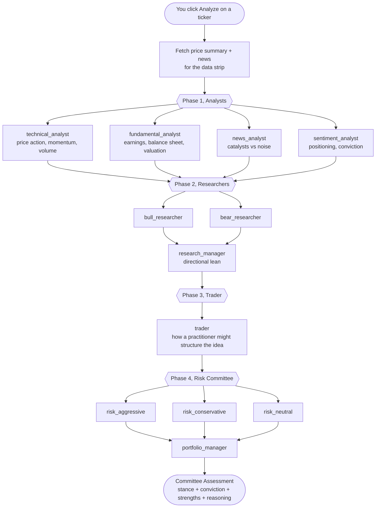
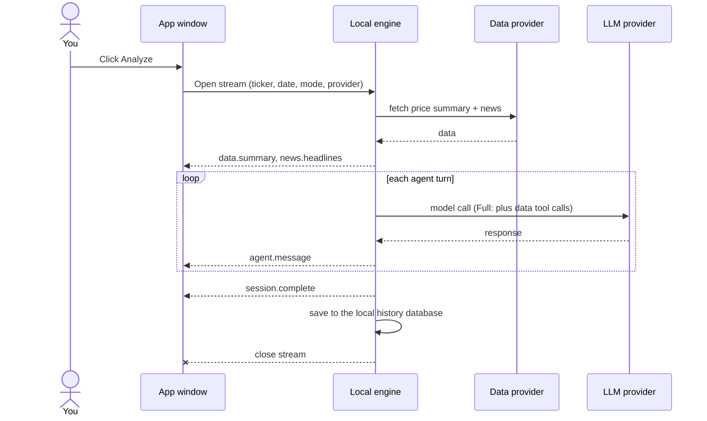

# How It Works

*A conceptual walkthrough of the multi-agent analysis pipeline in Trading Agents Lab Pro, from ticker input to committee assessment.*

> **For educational research and paper trading. This is not investment advice.**

---

## Overview

When you click **Analyze**, Trading Agents Lab Pro runs a structured debate among a fixed set of AI agents. Each agent plays a specific role. They work across four phases:

1. **Analysts**, gather and interpret data
2. **Researchers**, argue the bull and bear cases
3. **Trader**, describe how a practitioner might structure the idea
4. **Risk**, stress-test it, then a portfolio manager writes the final assessment

The output is a **committee assessment**: an analytical stance (Bullish through Bearish), a conviction score, bull and bear thesis strength scores, a risk level, and a reasoning paragraph. The app scores how the evidence was argued, not what action to take. Any investment decision is yours alone.

Pro can run this two ways, chosen with the **Mode** picker on the Analyze page: **Full analysis** and **Quick analysis**.

---

## Full analysis and Quick analysis

| | Full analysis (default) | Quick analysis |
|---|---|---|
| What runs | The upstream TradingAgents LangGraph graph itself | A shorter debate with twelve agents, one pass |
| Analysts | Call data tools at run time | Read a data summary the app fetched first |
| Debate | Bull and bear researchers argue for 1 to 4 rounds, then a risk team does the same | One turn per agent |
| Models | A deep model and a quick model (see below) | The one model you picked |
| Settings that apply | The Analysis tab: analysts, news source, fundamentals source, debate rounds, reasoning effort, token cap | None of them |
| Typical time | The page shows "Typically 8 to 15 minutes" | Usually about a minute |
| Providers | API key or OpenAI ChatGPT sign-in | Also local runtimes (Ollama, LM Studio) |
| Cost Guard | Pro full-graph estimate, with a mid-run stop | The simplified estimate used by the Lite app |

The mode you pick is remembered and also applies to batch runs. History marks each saved run **Full** or **Quick**. Runs saved before Pro 1.1.10 show no mode.

### Full analysis

Full analysis runs the real upstream graph with the library's own agent prompts left as published. The analyst team calls tools to fetch price history, indicators, fundamentals and news, rather than reading one pre-made summary. After the debates, a post-run call to the quick model scores the bull and bear cases (0 to 100 each) and the risk level.

**Deep and quick models.** The graph uses two model roles. The research manager and the portfolio manager use the deep model. The analysts, bull and bear researchers, trader and risk analysts, and the scoring call use the quick model. In Pro 1.1.10 both roles use the model you pick on the Analyze page; there is no separate picker for each role.

**Analysts.** Settings, Analysis lists four analyst seats: Market (technical), Social sentiment, News and Fundamentals. A fresh install runs Market only. All four run on free data, so you can tick the others without adding a key. Each extra analyst adds model calls, so the run costs more.

**Rounds.** Settings, Analysis also sets research rounds (bull against bear) and risk rounds (aggressive, conservative, neutral), each from 1 to 4. The default is 1 of each. More rounds mean a deeper and more expensive run. With the defaults and Market only, a run shows 1 analyst message, 3 researcher messages, 1 trader message and 4 risk messages.

**Reasoning effort.** An optional setting that applies only to Anthropic models that accept it (Claude Opus 4.5 and later, Sonnet 4.6 and later, Fable 5 and later, not Haiku) when both model roles accept it. It is ignored for other providers.

**Token cap.** An optional per-run limit on total tokens. The run stops with an "Analysis stopped" notice when it is crossed. Because the check runs after each model call, a run can slightly pass the cap.

**News source.** Settings, Analysis, News source sets where the News analyst gets headlines: **Auto (Alpaca when connected, else Yahoo)**, **Alpaca (Benzinga)**, **Yahoo Finance** or **Alpha Vantage** (your own key; news needs a paid Alpha Vantage plan). Yahoo Finance stays as the fallback whenever another source is in the chain. A separate **Fundamentals source** setting chooses Yahoo Finance (the default) or Alpha Vantage for the Fundamentals analyst. See [data-providers.md](data-providers.md).

**Memory.** After a Full run the engine saves the committee's decision to a local memory log, and a later run on the same ticker can read earlier entries. It is best-effort and stays on your machine.

**Cost Guard.** Before a Full run starts, Cost Guard reserves an estimate against your daily, weekly and monthly caps. Because the graph has no per-call output limit, the estimate is a calibrated "about 1.4 times a typical run" figure, and the real protection is a stop in the middle of the run: if the next model call could push the run past your remaining headroom, the run halts and shows an "Analysis stopped" notice. If you override a cap, or Cost Guard has no dollar cap enabled, a run is stopped at about three times its estimate. A Full run keeps its reservation for up to 60 minutes (15 for Quick). Spend from a stopped run still counts toward your totals. See [cost-guard.md](cost-guard.md).

### Quick analysis

Quick analysis is the shorter debate: twelve agents run one at a time on the one model you picked, in a fixed order. Each agent gets a ticker, the as-of date, a summary of recent price data (last close, period range, average volume) and recent headlines, plus the transcript so far. Bounds:

- **12 agents per session**
- **400 tokens per agent by default**, with a hard ceiling of 800 (reasoning models get an additional thinking allowance on top)

Quick analysis is the faster, cheaper way to see the pipeline at work.

### Sample debate (no provider configured)

If no LLM provider is configured, either mode runs a canned sample debate from `engine/stub_debate.py`. The structure, phases and agent order match a live run, and the messages reference real data fetched from Yahoo Finance (last close, period change, range, average volume, headlines), but the reasoning is templated. It costs nothing. The LLM pill in the status strip reads **unconfigured** in this state.

---

## The pipeline



In a Full analysis, the analyst seats you did not select are skipped, and the researcher and risk phases repeat for the number of rounds you set. In every mode, later agents read what earlier agents wrote, so the bull researcher reads the analyst reports, the trader reads the bull, bear and manager debate, and the risk committee reads the trader's plan.

---

## Phase 1: Analysts

| Agent | Role | Setting name |
|---|---|---|
| `technical_analyst` | Price action, trend, momentum, support and resistance, volume | Market (technical) |
| `fundamental_analyst` | Earnings, margins, balance sheet, valuation | Fundamentals |
| `news_analyst` | Recent headlines, catalysts vs. noise, what is missing | News |
| `sentiment_analyst` | What price action and headlines imply about positioning and conviction | Social sentiment |

In a Full analysis only the seats you selected run, and each one calls data tools itself. In Quick analysis all four run on the shared data summary, and the sentiment seat also reads a StockTwits and Reddit block fetched before the run (see [sentiment.md](sentiment.md)). In a Full analysis the Social sentiment analyst fetches its own sentiment data through tools.

---

## Phase 2: Researchers

| Agent | Role |
|---|---|
| `bull_researcher` | The strongest defensible case for the upside, anchored on the data |
| `bear_researcher` | The strongest defensible case for the downside or for staying out |
| `research_manager` | Weighs both sides and decides which carries the better risk-adjusted argument |

The research manager produces a directional lean. It is an input to the trader, not the final assessment. In a Full analysis, messages from later rounds are labeled with their round number.

---

## Phase 3: Trader

A single trader agent takes the analyst and researcher output and describes how a hypothetical practitioner might structure the idea: whether the setup looks actionable, what size posture it would merit, and what level would invalidate the thesis. This is part of the simulated committee's analytical exercise, not an instruction to trade. Trading language inside the transcript is simulated committee speech.

---

## Phase 4: Risk

Three risk seats stress-test the trader's plan from different angles. The portfolio manager writes the final assessment.

| Agent | Role |
|---|---|
| `risk_aggressive` | What does the team risk by being too cautious? |
| `risk_conservative` | What does the team risk by being too aggressive? |
| `risk_neutral` | Lowest-regret course of action given both views |
| `portfolio_manager` | Final committee assessment |

---

## How the assessment is produced

The assessment has the same shape in both modes: a stance, a conviction from 0 to 1, bull and bear thesis strengths from 0 to 100, a risk level (low, moderate or elevated) and reasoning.

**Full analysis.** The upstream portfolio manager writes a five-step rating, and Trading Agents Lab Pro maps it to an analytical stance before showing it. The rating word itself is never shown as the app's own output. The conviction is a fixed value for each step:

| Upstream rating | Stance shown | Conviction |
|---|---|---|
| Buy | Bullish | 0.85 |
| Overweight | Moderately bullish | 0.65 |
| Hold | Neutral | 0.50 |
| Underweight | Moderately bearish | 0.65 |
| Sell | Bearish | 0.85 |

If the rating cannot be read, the stance falls back to Neutral at 0.50. The conviction therefore reflects how far the stance sits from neutral, not a probability. When the portfolio manager names a price level and a time horizon, they are shown as **Modeled scenario** and **Horizon**: an output of the simulated committee, not a target to act on. Thesis strengths and risk level come from the post-run scoring call. If that call fails, those bars are hidden and the rest of the assessment still appears.

**Quick analysis.** The portfolio manager writes the stance, conviction, strengths, risk level and reasoning directly. The parser is tolerant: if the formatting drifts, it falls back to a neutral stance, 0.5 conviction, 50 and 50 thesis strengths and moderate risk.

At the end of a run the engine sends a `session.complete` event with the assessment, for example:

```json
{
  "type": "session.complete",
  "ticker": "NVDA",
  "trade_date": "2026-05-08",
  "decision": {
    "stance": "neutral",
    "conviction": 0.5,
    "bull_strength": 55,
    "bear_strength": 50,
    "risk_level": "moderate",
    "reasoning": "..."
  },
  "live": true,
  "model": "claude-sonnet-4-6",
  "input_tokens": 48230,
  "output_tokens": 19220,
  "estimated_cost_usd": 0.31
}
```

The number values here are illustrative. The UI colors the card green for bullish stances, red for bearish stances and amber for neutral. ChatGPT sign-in runs report an estimated cost of 0 because they bill against your ChatGPT plan, not per token, and local-runtime runs report 0 because they cost nothing per token.

---

## Data flow



The app window shows events as they arrive. After `session.complete`, the engine saves the full session (events, assessment, token counts, mode) to the local `sessions.db` so the History page can replay it later. A Full run that stops early (cost cap, token cap or an error) ends with a stop or error notice instead of an assessment, and its spend is still recorded. Everything between the window and the engine stays on `127.0.0.1`.

---

## Upstream relationship

Trading Agents Lab is forked from [Tauric Research's TradingAgents](https://github.com/TauricResearch/TradingAgents), which implements a LangGraph-based multi-agent pipeline. Trading Agents Lab Pro runs that graph itself for a Full analysis, with the library's own agent prompts left as published. What Pro adds is the desktop interface, key handling, Cost Guard, and the presentation layer that turns the graph's rating into an analytical stance. The shorter sequential debate is what a Quick analysis runs.

---

## Further reading

- [Data providers](data-providers.md), what data the analysts see
- [Configuring LLM providers](configuring-llm-providers.md), keys, models and sign-in
- [OAuth](oauth.md), ChatGPT subscription routing
- [Cost Guard](cost-guard.md), caps, reservations and the spend pill
- [Reading the debate](reading-the-debate.md), how the Analyze page presents the stream
- [Engine API contract](https://github.com/RBJGlobal/TradingAgentsLab-Pro/blob/main/docs/api.md)
